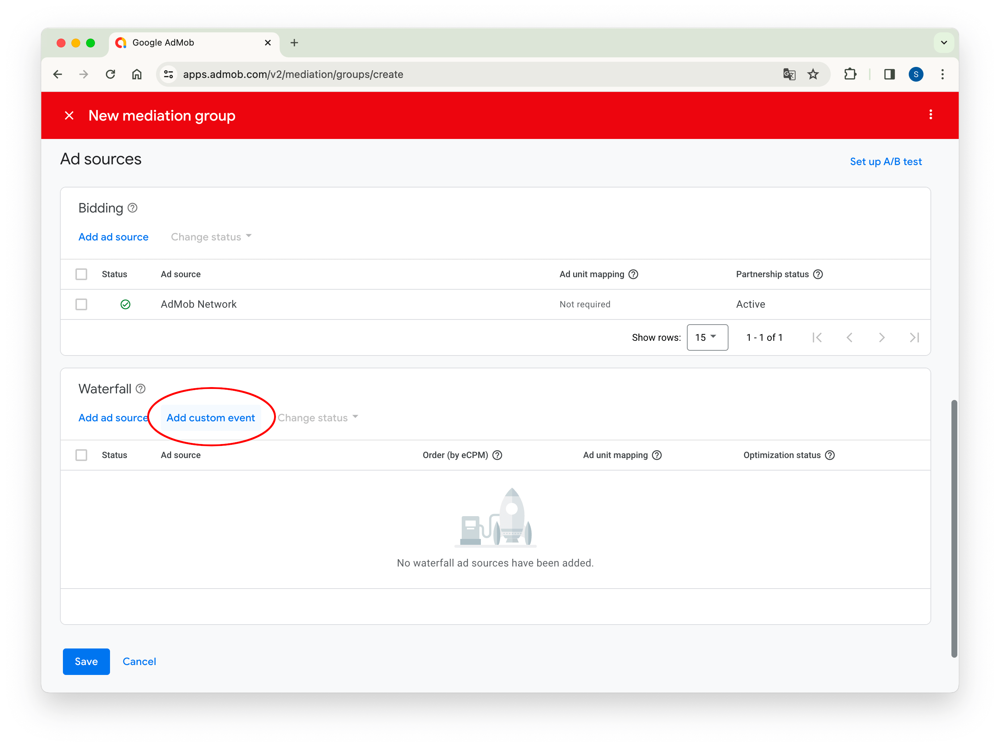
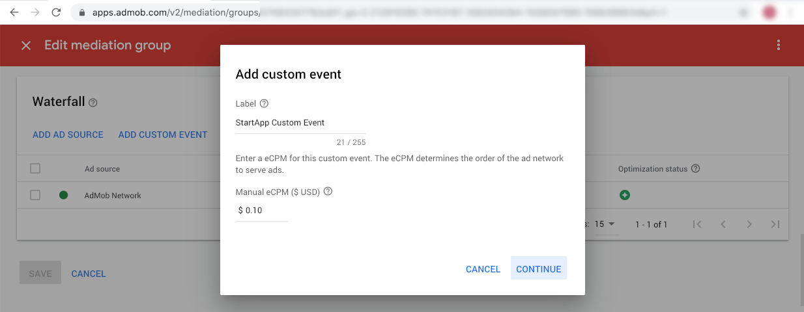
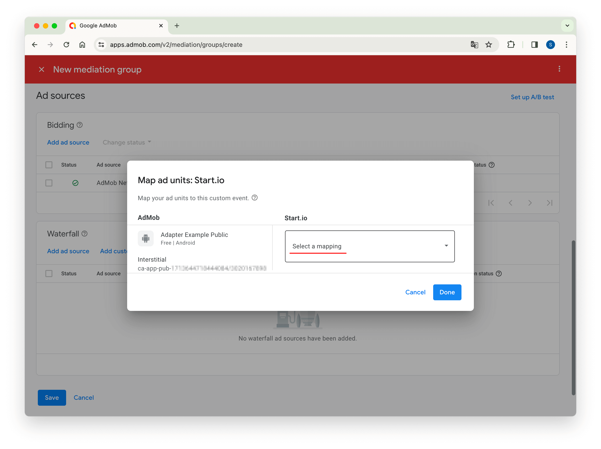
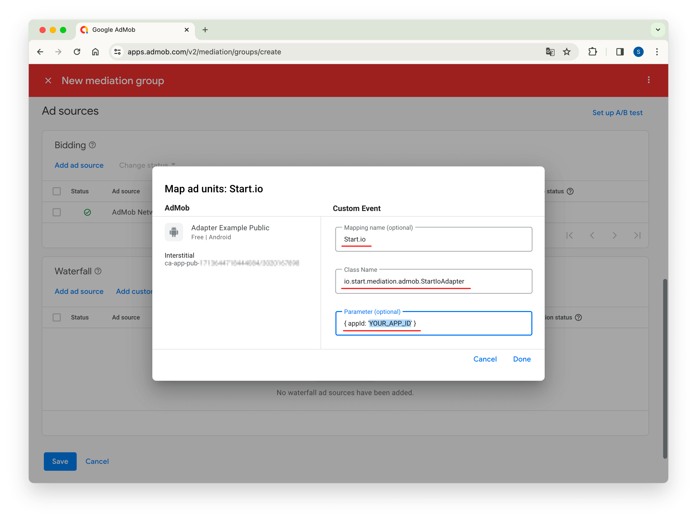
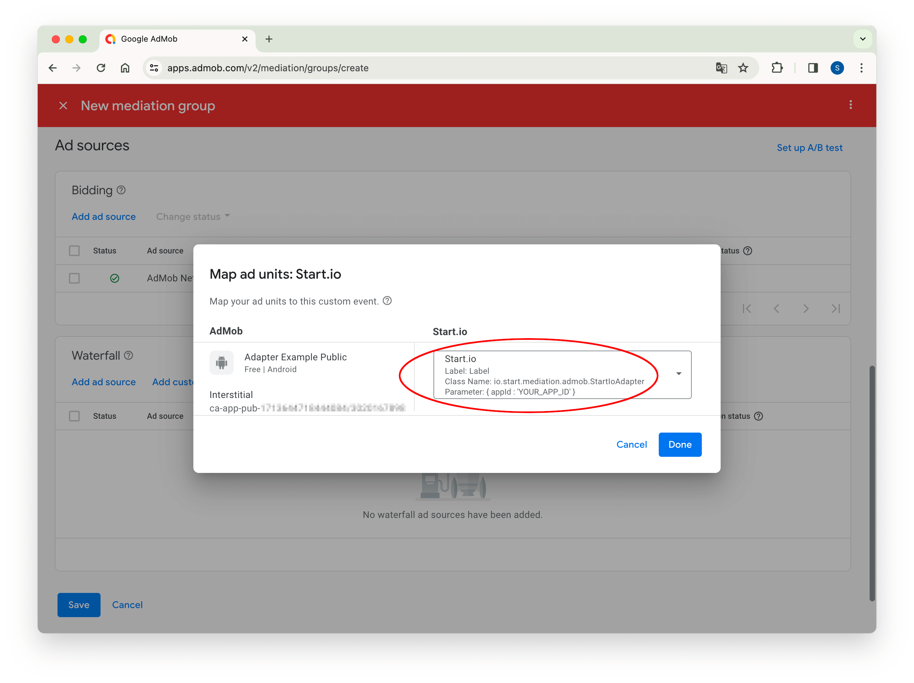
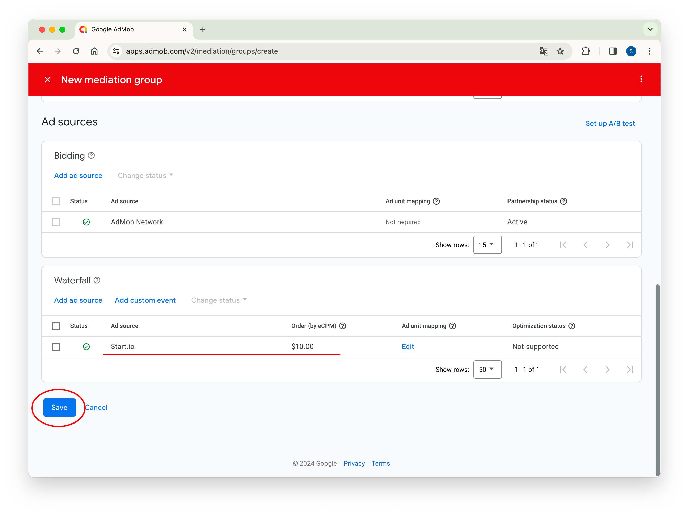

# Start.io (StartApp) mediation adapter for AdMob

This library lets you serve ads to your apps from Start.io (StartApp) network via AdMob integration.

## Demo app

The [demo app](/example) is fully workable. By default it shows Google test ads. To test your integration, put your App ID in [AndroidManifest.xml](/example/src/main/AndroidManifest.xml), put your ad unit IDs in `productionAdUnits()` and set `TEST_ADS` to `false` in [MainActivity.java](/example/src/main/java/com/startapp/mediation/admob/example/MainActivity.java). With `TEST_ADS = false`, the demo app shows only ads served by Start.io. Then build an app and use [Ad inspector][1] to make sure your integration is working correctly.

## Compatibility report

For each AdMob version, the demo app was checked with these ad formats:

- Interstitial
- Rewarded Video
- Banner 320x50
- Banner 300x250 (MREC)
- Native

AdMob versions:

- 24.0.0
- 24.1.0
- 24.2.0
- 24.3.0
- 24.4.0
- 24.5.0
- 24.6.0
- 24.7.0
- 24.8.0
- 24.9.0
- 25.0.0
- 25.1.0
- 25.2.0
- 25.3.0
- 25.4.0
- 25.5.0

## Integration steps

1. Add dependency on Start.io (StartApp) AdMob Mediation library.

```
dependencies {
    implementation 'io.start:admob-mediation:3.2+'
}
```

2. Create new or edit existing Mediation Group, then click `Add custom event`.



3. Fill the fields `Label` and `Manual eCPM`, then click `Continue`.



4. Create a mapping for each ad unit.



5. Fill the fields `Mapping name`, `Class Name` and `Parameter`, then click `Done`.

Make sure to change string `YOUR_APP_ID` with the actual app ID from the [portal.start.io](https://portal.start.io).

Mapping name: `Start.io`

Class Name: `io.start.mediation.admob.StartIoAdapter`

Parameter: `{ appId : 'YOUR_APP_ID' }`

**Advanced option**:

Pass `adTag` to the parameter: `{ appId : 'YOUR_APP_ID', adTag: 'YOUR_AD_TAG' }`



6. Select a mapping, then click `Done`.



7. Make sure new ad source is appeared in list, then click `Save`.



[1]: https://developers.google.com/admob/android/ad-inspector
